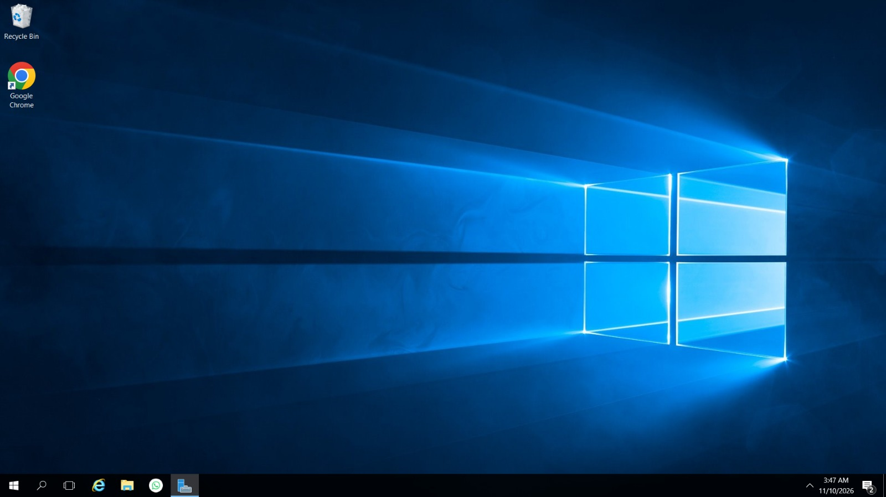
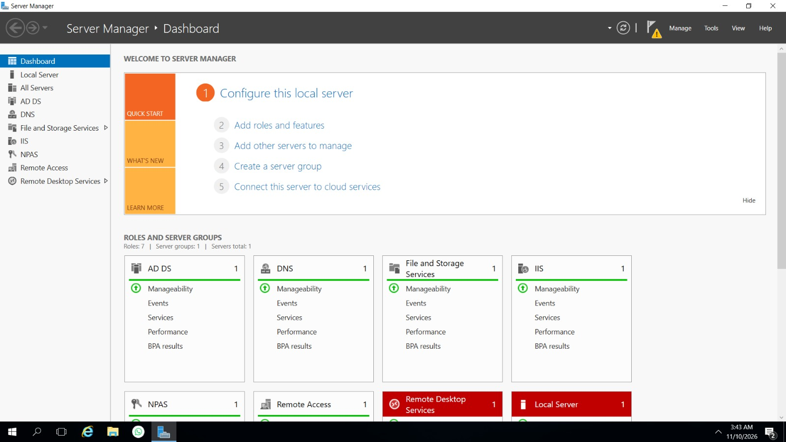
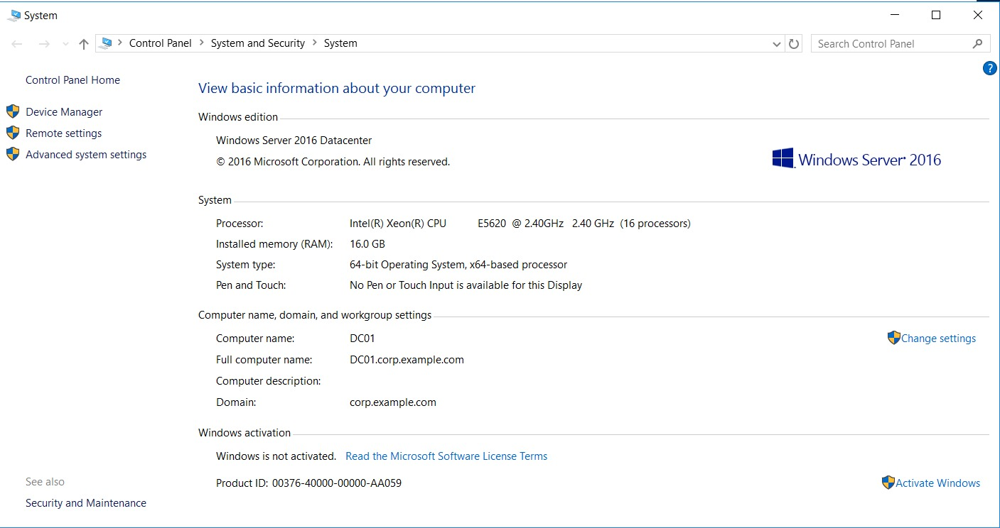

# Installation Screenshots

This gallery contains the first three user-supplied screenshots for the Windows Server installation project. The images are included as provided; descriptions identify only what is visible and do not assert that unverified configuration is complete.

## 01 — Windows Server 2016 Desktop

Shows the Windows Server 2016 operating system desktop.

## 02 — Server Manager Dashboard

Shows the Server Manager dashboard and server management interface.

## 03 — Server Information

Shows the Windows Server system information and operating system details.

